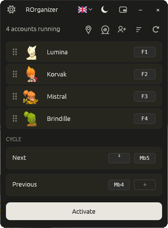

<div align="center">


# ROrganizer

**Manage your Dofus Unity and Retro accounts from the keyboard. Open-source. No telemetry.**

*Playing up to 8 accounts in parallel? Switch between them with **a single keystroke or mouse click**, invite your whole team into a group, send it to the same zaap or to an NPC **in one click**. No network connection, no bloat.*

[](https://github.com/ptuet/ROrganizer/releases)
[](#license)
[](https://github.com/ptuet/ROrganizer/releases)
[](https://www.rust-lang.org/)
[](#-your-privacy)

<a href="README.md"> Français</a> &nbsp;·&nbsp;  **English** &nbsp;·&nbsp; <a href="README.es.md"> Español</a>

</div>

---

> 🍴 **This is a fork** of [Loulouw/ROrganizer](https://github.com/Loulouw/ROrganizer),
> the open-source organizer created by **Loulouw**. This fork fixes a few
> in-game issues and adds multi-account features. All credit for the
> original application goes to its author.

> ⚠️ **Beware of impostors.** This fork's releases are downloaded
> **only** from the [Releases page of this repo](https://github.com/ptuet/ROrganizer/releases),
> as **a single executable**. Never inside an archive, never as a script,
> never from a file host or a link shared elsewhere — see
> [SECURITY.md](SECURITY.md) to verify your download.

## Preview

<div align="center">
  
</div>

## Why ROrganizer?

Inspired by **nAiO Organizer** — a tool well-known in the Dofus
community — but **fully open-source**. For a tool that listens to your
keyboard shortcuts and watches your Dofus windows, that's what changes
everything.

- 🔍 **Public source code**. Anyone can read it and verify there's no
  keylogger, no telemetry, no hidden network connection.
- 🔒 **Verifiable binary**. Every release is built by GitHub from the
  public source, never on a personal machine, with a provenance
  attestation you can check in one command. Nobody else can produce
  one. See [SECURITY.md](SECURITY.md).
- 🛠️ **Future-proof**. If the project stops, anyone can pick it up —
  this fork is the proof.

## ✅ Your privacy

> **Offline · No data collected**

- The app **never connects to any server**.
- The app **doesn't read or modify Dofus**. To switch accounts, it just
  listens for your shortcuts and brings the right window to the front.
- **Only the "group invite", "zaap" and "NPC" buttons** send something
  to the game: they type `/invite <name>`, `/zaap x,y` or `/travel x,y`
  in the chat for you and can press the "follow the group leader" key
  (Ctrl+W by default), and only when you click them.
- **No keystrokes are logged**. Shortcuts are matched on the fly and
  immediately forgotten.
- The only file the app writes is **its own settings** (your shortcuts,
  language and theme) in the Windows AppData folder.

## ⚡ Performance

<div align="center">
  
</div>

## Features

- 🔍 **Auto-detects** your accounts as soon as they're running, whether
  you play on **Dofus**, **Dofus Retro** or **Dofus Experimental**
- 🎯 **One shortcut per account**: keyboard key or mouse button,
  including **AZERTY** keys such as `²`, `ù` or `)`
- 🔄 **Cycle through accounts** with a next / previous shortcut —
  **two shortcuts possible** for each (a key and a mouse button, for
  example)
- 🖱️ **The cycle follows the active window**: if you switch account
  with the mouse, "next" continues from where you really are
- ✋ **Drag-and-drop** to reorder accounts however you want
- 📊 **Windows taskbar sorting** in the same order, in one click
- 👥 **Group invite**: the group leader invites all the others (the
  first of the list by default, your choice in the settings)
- 🌀 **Zaap for everyone**: search a zaap by name and all your accounts
  teleport there (`/zaap`, Dofus 3.7+); the group leader then turns on
  follow (option)
- 🧭 **Travel to an NPC**: search ~1,800 NPCs by name or area; all your
  accounts go to the nearest zaap, then the group leader travels
  (`/travel`) and the others follow (option)
- ⭐ **Favorites**: up to 5 zaaps and 5 NPCs pinned at the top of their
  list
- 🔳 **Mini mode**: a small bar with the NPC, zaap and invite buttons,
  to keep on top of the game ("Always on top" option). As a row or a
  square, it stays where you put it, and its dots turn green when your
  shortcuts are active
- 🌓 **Light or dark theme**, in FR / EN / ES
- 📍 **Discreet**: minimizes to the system tray, or to the taskbar if
  you'd rather keep the buttons one click away (option in the settings)

## Get started in 3 steps

<div align="center">

| 1️⃣ &nbsp; **Download** | 2️⃣ &nbsp; **Run** | 3️⃣ &nbsp; **Configure** |
|:--|:--|:--|
| Grab the `.exe` from [Releases](https://github.com/ptuet/ROrganizer/releases). No installer, no dependencies. | Double-click the `.exe`. That's it. ROrganizer auto-detects any Dofus accounts you've already launched. | Click **"set"** next to an account, then press the key or mouse button you want to bind. |

[](https://github.com/ptuet/ROrganizer/releases/latest)

</div>

Works on Windows 10 and Windows 11.

> 💡 **Prefer to build from source?**
> With the `stable-x86_64-pc-windows-msvc` Rust toolchain (via [rustup](https://rustup.rs)):
> ```powershell
> cargo build --release
> .\target\release\rorganizer.exe
> ```
> The `main` branch builds the full version, the `vanilla` branch the
> version that never sends commands to the game.

## FAQ

**Do I have to configure each account one by one?**
No. ROrganizer **auto-detects** every Dofus account as soon as it
launches, on the regular client as well as **Dofus Retro** and
**Dofus Experimental**. You just bind a shortcut by clicking "set" next
to each account — it's remembered. Retro accounts show no class icon:
their window doesn't carry it.

**What does it consume while I'm playing?**
Very little: **~75 MB of RAM and 0% CPU at idle**. The app stays silent
in the background until you press one of your shortcuts.

**Could I get banned for using this?**
For switching accounts, ROrganizer **does not interact with Dofus**: it
brings a window to the front, exactly like `Alt+Tab`. The **group
invite**, **zaap** and **NPC** buttons go further: they type chat
commands in several accounts from a single click. Ankama publishes no
clear rule on this, and an action that acts on several accounts at once
is the most sensitive area. If you want to avoid any risk, use the
[vanilla version](#vanilla-version). In any case, using third-party
tools is at your own risk regarding Ankama's terms of service.

**The invite, zaap and NPC buttons do nothing, or open the game menu?**
The app opens the chat with **Space** and turns on leader follow with
**Ctrl+W**, Dofus's default keys. If you changed them in the game's
shortcuts, set the same ones in the **Multi-account** tab of the
settings (the gear).

**Do shortcuts work while I'm in-game?**
Yes. Shortcuts are listened to **at the Windows system level**, so they
work no matter which window is in front (Dofus, your browser, another
app…). One caveat: if Dofus runs as **administrator**, run ROrganizer as
administrator too.

**Windows shows a blue warning at first launch, is this normal?**
Yes. ROrganizer isn't signed with a **code-signing certificate** (which
costs around €300/year and isn't justifiable for a free open-source
project). Windows SmartScreen therefore warns about any executable it
doesn't know well yet. Click **"More info"** then **"Run anyway"**. To
make sure you have the right binary, the procedure is in
[SECURITY.md](SECURITY.md): comparing the **SHA256** GitHub shows on the
release page, and a **provenance attestation** you can check in one
command.

**My antivirus flags a "trojan", is the app dangerous?**
No, it's a **false positive**. To fire your shortcuts even while Dofus
is in front, ROrganizer has to listen to the keyboard and mouse at the
Windows system level, then bring a window forward. An antivirus that
judges a program by its shape, without reading its code, can't tell
that mechanism apart from spyware. The name it shows (often `Wacatac`)
is a generic label assigned automatically, not the identification of a
known virus.

What you can check yourself: the source code is public, **no keystroke
is ever recorded** and the app **never connects to any server** — you
can confirm it in Windows Resource Monitor. Until Microsoft fixes the
false positive, you can add the `.exe` as an exclusion in your
antivirus, after checking its SHA256.

**How do I uninstall it?**
Just delete the `.exe`. Your preferences are stored in
`%APPDATA%\rorganizer\` — delete that folder for a full clean-up.
**No Windows registry changes, no service installed.**

**I found a bug, where do I report it?**
In [this fork's issues](https://github.com/ptuet/ROrganizer/issues), or
with **"Report a bug"** in the app's settings. For a bug that also
exists in the original version, you can report it to
[the author](https://github.com/Loulouw/ROrganizer/issues) too.

## Vanilla version

There is also a **vanilla** version, without the invite, zaap and NPC
buttons or the mini mode: it only switches windows and **never sends
anything to the game**. It is downloaded from the same
[Releases](https://github.com/ptuet/ROrganizer/releases) page, as
`ROrganizer-<version>-vanilla-x86_64-windows.exe`.

## Credits

ROrganizer was created by **[Loulouw](https://github.com/Loulouw)** —
original repository: [Loulouw/ROrganizer](https://github.com/Loulouw/ROrganizer).
This fork is maintained by **[ptuet](https://github.com/ptuet)**. The
zaap and NPC lists come from the community database
[DofusDB](https://dofusdb.fr).

## Disclaimer

Third-party tool, not affiliated with Ankama Games or the Dofus game.
Use at your own risk and check the Dofus terms of service before use.

Some illustrations displayed in the application are the property of
Ankama Studio. **Dofus** and related artwork are trademarks of
Ankama — all rights reserved. They are used here for illustrative,
non-commercial purposes only.

## License

Dual-licensed at your choice:

- [MIT](LICENSE-MIT)
- [Apache 2.0](LICENSE-APACHE)

Contributions are implicitly covered by this dual licensing unless
explicitly stated otherwise.
