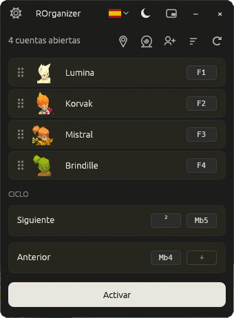

<div align="center">


# ROrganizer

**Gestiona tus cuentas Dofus Unity y Retro desde el teclado. Open-source. Sin telemetría.**

*¿Juegas con hasta 8 cuentas en paralelo? Cambia entre ellas **con una sola pulsación de tecla o ratón**, invita a todo tu equipo a un grupo, envíalo al mismo zaap o hacia un PNJ **con un clic**. Sin conexión a internet, sin saturación.*

[](https://github.com/ptuet/ROrganizer/releases)
[](#licencia)
[](https://github.com/ptuet/ROrganizer/releases)
[](https://www.rust-lang.org/)
[](#-respeto-a-tu-privacidad)

<a href="README.md"> Français</a> &nbsp;·&nbsp; <a href="README.en.md"> English</a> &nbsp;·&nbsp;  **Español**

</div>

---

> 🍴 **Esto es un fork** de [Loulouw/ROrganizer](https://github.com/Loulouw/ROrganizer),
> el organizer open-source creado por **Loulouw**. Este fork corrige
> algunos problemas encontrados en el juego y añade funciones para el
> multicuenta. Todo el mérito de la aplicación original es de su autor.

> ⚠️ **Cuidado con las falsificaciones.** Las versiones de este fork se
> descargan **únicamente** desde la [página de Releases de este repositorio](https://github.com/ptuet/ROrganizer/releases),
> como **un solo ejecutable**. Nunca dentro de un archivo comprimido, nunca
> como script, nunca desde un alojamiento de archivos o un enlace
> compartido en otro sitio — consulta [SECURITY.md](SECURITY.md) para
> verificar tu descarga.

## Vista previa

<div align="center">
  
</div>

## ¿Por qué ROrganizer?

Inspirado en **nAiO Organizer** — una herramienta que la comunidad
Dofus conoce bien — pero **totalmente open-source**. Para una
herramienta que escucha tus atajos de teclado y observa tus ventanas
Dofus, eso lo cambia todo.

- 🔍 **Código fuente público**. Cualquiera puede leerlo y verificar que
  no hay keylogger, ni telemetría, ni conexión de red oculta.
- 🔒 **Binario verificable**. Cada release la compila GitHub desde el
  código público, nunca en una máquina personal, con una atestación de
  procedencia que puedes comprobar con un solo comando. Nadie más puede
  generar una. Consulta [SECURITY.md](SECURITY.md).
- 🛠️ **Continuidad**. Si el proyecto se detiene, cualquiera puede
  retomarlo — este fork es la prueba.

## ✅ Respeto a tu privacidad

> **Sin conexión · Sin recolección de datos**

- La app **nunca se conecta a ningún servidor**.
- La app **no lee ni modifica Dofus**. Para cambiar de cuenta, solo
  escucha tus atajos y trae la ventana correcta al frente.
- **Solo los botones «invitar al grupo», «zaap» y «PNJ»** envían algo
  al juego: escriben por ti `/invite <nombre>`, `/zaap x,y` o
  `/travel x,y` en el chat y pueden pulsar la tecla «seguir al jefe de grupo»
  (Ctrl+W por defecto), y solo cuando haces clic en ellos.
- **No se registra ninguna pulsación de tecla**. Los atajos se
  identifican al vuelo y se olvidan al instante.
- El único archivo que la app escribe es **su propia configuración**
  (tus atajos, tu idioma, tu tema) en la carpeta AppData de Windows.

## ⚡ Rendimiento

<div align="center">
  
</div>

## Funcionalidades

- 🔍 **Detección automática** de tus cuentas en cuanto se inician, tanto
  si juegas en **Dofus**, **Dofus Retro** o **Dofus Experimental**
- 🎯 **Un atajo por cuenta**: tecla del teclado o botón del ratón,
  incluidas las teclas de un teclado **AZERTY** como `²`, `ù` o `)`
- 🔄 **Ciclo entre tus cuentas** con un atajo siguiente / anterior —
  **dos atajos posibles** para cada uno (una tecla y un botón del
  ratón, por ejemplo)
- 🖱️ **El ciclo sigue la ventana activa**: si cambias de cuenta con el
  ratón, el «siguiente» continúa desde donde estás realmente
- ✋ **Arrastrar y soltar** para ordenar tus cuentas a tu gusto
- 📊 **Ordenar la barra de tareas** de Windows en el mismo orden, con un
  clic
- 👥 **Invitación de grupo**: el jefe de grupo invita a todos los demás
  (por defecto el primero de la lista, a elegir en los ajustes)
- 🌀 **Zaap para todos**: busca un zaap por su nombre y todas tus cuentas
  se teletransportan allí (`/zaap`, Dofus 3.7+); después el jefe de
  grupo activa el seguimiento (opción)
- 🧭 **Trayecto hacia un PNJ**: busca entre ~1 800 PNJ por nombre o por
  zona; todas tus cuentas van al zaap más cercano, luego el jefe de grupo hace
  el trayecto (`/travel`) y los demás lo siguen (opción)
- ⭐ **Favoritos**: hasta 5 zaaps y 5 PNJ fijados arriba de su lista
- 🔳 **Modo mini**: una pequeña barra con los botones PNJ, zaap e
  invitación, para dejar encima del juego (opción «Siempre en primer
  plano»). En fila o en cuadrado, se queda donde la dejaste, y sus
  puntos se ponen verdes cuando tus atajos están activos
- 🌓 **Tema claro u oscuro**, en FR / EN / ES
- 📍 **Discreto**: se minimiza en la bandeja del sistema, o en la barra
  de tareas si prefieres tener los botones a un clic (opción en los
  ajustes)

## Empieza en 3 pasos

<div align="center">

| 1️⃣ &nbsp; **Descarga** | 2️⃣ &nbsp; **Lanza** | 3️⃣ &nbsp; **Configura** |
|:--|:--|:--|
| Descarga el `.exe` desde [Releases](https://github.com/ptuet/ROrganizer/releases). Sin instalador, sin dependencias. | Doble clic en el `.exe`. Eso es todo. ROrganizer detecta automáticamente tus cuentas Dofus ya abiertas. | Haz clic en **«definir»** junto a una cuenta y pulsa la tecla o el botón del ratón que quieras asignarle. |

[](https://github.com/ptuet/ROrganizer/releases/latest)

</div>

Compatible con Windows 10 y Windows 11.

> 💡 **¿Prefieres compilar desde el código fuente?**
> Con el toolchain Rust `stable-x86_64-pc-windows-msvc` (vía [rustup](https://rustup.rs)):
> ```powershell
> cargo build --release
> .\target\release\rorganizer.exe
> ```
> La rama `main` da la versión completa, la rama `vanilla` la versión
> que nunca envía comandos al juego.

## FAQ

**¿Tengo que configurar cada cuenta una por una?**
No. ROrganizer **detecta automáticamente** todas tus cuentas Dofus en
cuanto se inician, tanto en el cliente clásico como en **Dofus Retro** y
**Dofus Experimental**. Solo tienes que asignar un atajo a cada una
haciendo clic en «definir» — y queda guardado. Las cuentas de Retro se
muestran sin icono de clase: su ventana no lo indica.

**¿Cuánto consume mientras juego?**
Muy poco: **~75 MB de RAM y 0 % de CPU en reposo**. La app se queda
silenciosa en segundo plano hasta que pulsas un atajo.

**¿Puedo ser baneado por usarla?**
Para cambiar de cuenta, ROrganizer **no interactúa con Dofus**: trae una
ventana al frente, exactamente como `Alt+Tab`. Los botones **invitación
de grupo**, **zaap** y **PNJ** van más allá: escriben comandos de chat
en varias cuentas a partir de un solo clic. Ankama no publica ninguna
regla clara sobre esto, y una acción que actúa sobre varias cuentas a la
vez es la zona más sensible. Si quieres evitar cualquier riesgo, usa la
[versión vanilla](#versión-vanilla). En cualquier caso, el uso de
herramientas de terceros es bajo tu propia responsabilidad respecto a
las condiciones de uso de Ankama.

**¿Los botones invitación, zaap y PNJ no hacen nada, o abren el menú del juego?**
La app abre el chat con **Espacio** y activa el seguimiento del jefe
de grupo con **Ctrl+W**, las teclas por defecto de Dofus. Si las cambiaste en los
atajos del juego, pon las mismas en la pestaña **Multicuenta** de los
ajustes (el engranaje).

**¿Funcionan los atajos cuando estoy en el juego?**
Sí. Los atajos se escuchan **a nivel global de Windows**, así que
funcionan independientemente de la ventana en primer plano (Dofus,
navegador, otra app…). Una salvedad: si Dofus se ejecuta como
**administrador**, lanza ROrganizer también como administrador.

**Windows muestra una advertencia azul al primer arranque, ¿es normal?**
Sí. ROrganizer no está firmado con un **certificado de firma de código**
(que cuesta unos 300 €/año y no es justificable para un proyecto
open-source gratuito). Windows SmartScreen muestra entonces una alerta
por precaución sobre cualquier ejecutable poco conocido. Haz clic en
**«Más información»** y luego en **«Ejecutar de todos modos»**. Para
verificar que tienes el binario correcto, el procedimiento está
detallado en [SECURITY.md](SECURITY.md): comparación del **SHA256** que
GitHub muestra en la página de la release, y **atestación de
procedencia** verificable con un solo comando.

**Mi antivirus detecta un «troyano», ¿la app es peligrosa?**
No, es un **falso positivo**. Para activar tus atajos incluso cuando
Dofus está en primer plano, ROrganizer necesita escuchar el teclado y el
ratón a nivel global de Windows y luego traer una ventana al frente. Un
antivirus que juzga un programa por su forma, sin leer su código, no
puede distinguir ese mecanismo del de un programa espía. El nombre que
muestra (a menudo `Wacatac`) es una etiqueta genérica asignada
automáticamente, no la identificación de un virus conocido.

Lo que puedes comprobar tú mismo: el código fuente es público, **no se
registra ninguna pulsación de teclado** y la app **no se conecta a
ningún servidor** — verificable en el Monitor de recursos de Windows.
Mientras Microsoft corrige el falso positivo, puedes añadir el `.exe`
como exclusión en tu antivirus, después de comprobar su SHA256.

**¿Cómo desinstalo la aplicación?**
Simplemente borra el `.exe`. Tus preferencias se guardan en
`%APPDATA%\rorganizer\` — puedes borrar esa carpeta para una limpieza
completa. **Sin cambios en el registro de Windows, sin servicio
instalado.**

**Encontré un error, ¿dónde lo reporto?**
En los [issues de este fork](https://github.com/ptuet/ROrganizer/issues),
o con **«Reportar un error»** en los ajustes de la app. Para un error que
también existe en la versión original, puedes reportarlo también a
[su autor](https://github.com/Loulouw/ROrganizer/issues).

## Versión vanilla

También existe una versión **vanilla**, sin los botones invitación, zaap
y PNJ ni el modo mini: solo cambia de ventana y **nunca envía nada al
juego**. Se descarga desde la misma página de
[Releases](https://github.com/ptuet/ROrganizer/releases), con el nombre
`ROrganizer-<versión>-vanilla-x86_64-windows.exe`.

## Créditos

ROrganizer fue creado por **[Loulouw](https://github.com/Loulouw)** —
repositorio original: [Loulouw/ROrganizer](https://github.com/Loulouw/ROrganizer).
Este fork lo mantiene **[ptuet](https://github.com/ptuet)**. Las listas
de zaaps y PNJ vienen de la base comunitaria [DofusDB](https://dofusdb.fr).

## Aviso legal

Herramienta de terceros, sin afiliación con Ankama Games ni con el
juego Dofus. Úsala bajo tu propia responsabilidad y consulta las
condiciones de uso de Dofus antes de hacerlo.

Algunas ilustraciones mostradas en la aplicación son propiedad de
Ankama Studio. **Dofus** y las ilustraciones asociadas son marcas de
Ankama — todos los derechos reservados. Se usan aquí únicamente con
fines ilustrativos y no comerciales.

## Licencia

Distribuido bajo licencia dual, a tu elección:

- [MIT](LICENSE-MIT)
- [Apache 2.0](LICENSE-APACHE)

Cualquier contribución queda cubierta implícitamente por esta licencia
dual, salvo indicación contraria.
