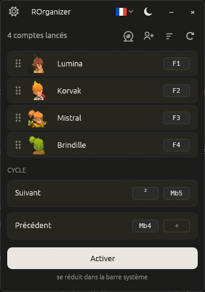

<div align="center">


# ROrganizer

**Gère tes comptes Dofus Unity et Rétro au clavier. Open-source. Sans télémétrie.**

*Tu joues jusqu'à 8 comptes en parallèle ? Bascule de l'un à l'autre **d'un seul appui clavier ou souris**, invite toute ton équipe en groupe ou envoie-la au même zaap **d'un clic**. Sans connexion réseau, sans usine à gaz.*

[](https://github.com/ptuet/ROrganizer/releases)
[](#licence)
[](https://github.com/ptuet/ROrganizer/releases)
[](https://www.rust-lang.org/)
[](#-respect-de-ta-vie-privée)

 **Français** &nbsp;·&nbsp; <a href="README.en.md"> English</a> &nbsp;·&nbsp; <a href="README.es.md"> Español</a>

</div>

---

> 🍴 **Ceci est un fork** de [Loulouw/ROrganizer](https://github.com/Loulouw/ROrganizer),
> l'organizer open-source créé par **Loulouw**. Ce fork corrige quelques
> problèmes rencontrés en jeu et ajoute des fonctionnalités pour le
> multicompte. Tout le mérite de l'application de base revient à son auteur.

## Deux versions, au choix

| | **ROrganizer** | **ROrganizer vanilla** |
|---|---|---|
| Fichier | `ROrganizer-<version>-x86_64-windows.exe` | `ROrganizer-<version>-vanilla-x86_64-windows.exe` |
| Changement de compte, cycle, tri, barre des tâches | ✅ | ✅ |
| **Inviter tous les comptes en groupe** | ✅ | — |
| **Envoyer tous les comptes au même zaap** | ✅ | — |
| Envoie des commandes au jeu | **Oui**, uniquement quand tu cliques sur ces deux boutons | **Jamais** |

Les deux se téléchargent sur la page [Releases](https://github.com/ptuet/ROrganizer/releases).
Si tu veux un outil qui ne fait **que** changer de fenêtre, prends la
version **vanilla**.

> ⚠️ **Attention aux contrefaçons.** Les versions de ce fork se
> téléchargent **uniquement** sur la page [Releases de ce dépôt](https://github.com/ptuet/ROrganizer/releases),
> sous la forme d'**un seul exécutable**. Jamais dans une archive, jamais
> sous forme de script, jamais depuis un hébergeur de fichiers ou un lien
> partagé ailleurs — voir [SECURITY.md](SECURITY.md) pour vérifier ton
> téléchargement.

## Aperçu

<div align="center">
  
</div>

## Pourquoi ROrganizer ?

Inspiré de **nAiO Organizer** — un outil que la communauté Dofus connaît
bien — mais **entièrement open-source**. Pour un outil qui écoute tes
raccourcis clavier et observe les fenêtres Dofus, c'est ce qui change
tout.

- 🔍 **Code source public**. N'importe qui peut le lire et vérifier
  qu'il n'y a aucun keylogger, aucune télémétrie, aucune connexion
  réseau cachée.
- 🔒 **Binaire vérifiable**. Chaque release est compilée par GitHub
  depuis le code public, jamais sur une machine personnelle, avec une
  attestation de provenance que tu peux contrôler en une commande.
  Personne d'autre ne peut en produire une. Voir
  [SECURITY.md](SECURITY.md).
- 🛠️ **Pérennité**. Si le projet s'arrête, n'importe qui peut le
  reprendre — ce fork en est la preuve.

## ✅ Respect de ta vie privée

> **Hors-ligne · Aucune donnée collectée**

- L'app **ne se connecte à aucun serveur**, jamais.
- L'app **ne lit pas Dofus et ne le modifie pas**. Pour changer de
  compte, elle se contente d'écouter tes raccourcis et de mettre la
  bonne fenêtre devant.
- **Seuls les boutons « invitation de groupe » et « zaap »** envoient
  quelque chose au jeu : ils tapent pour toi `/invite <pseudo>` ou
  `/zaap x,y` dans le chat, et seulement quand tu cliques dessus. La
  version **vanilla** n'a pas ces boutons.
- **Aucune frappe clavier n'est enregistrée**. Les raccourcis sont
  identifiés à la volée puis oubliés.
- Le seul fichier que l'app écrit, c'est **sa propre configuration**
  (tes raccourcis, ta langue, ton thème) dans le dossier AppData de
  Windows.

## ⚡ Performances

<div align="center">
  
</div>

## Fonctionnalités

- 🔍 **Détection automatique** de tes comptes dès qu'ils sont lancés, que
  tu joues sur **Dofus**, **Dofus Rétro** ou **Dofus Expérimental**
- 🎯 **Un raccourci par compte** : touche du clavier ou bouton de souris,
  y compris les touches d'un clavier **AZERTY** comme `²`, `ù` ou `)`
- 🔄 **Cycle entre tes comptes** avec un raccourci suivant / précédent —
  **deux raccourcis possibles** pour chacun (une touche et un bouton de
  souris, par exemple)
- 🖱️ **Le cycle suit la fenêtre active** : si tu changes de compte à la
  souris, le « suivant » repart de là où tu es vraiment
- ✋ **Glisse-dépose** pour ranger tes comptes dans l'ordre que tu veux
- 📊 **Tri de la barre des tâches** Windows dans le même ordre, d'un clic
- 👥 **Invitation de groupe** : le premier compte de la liste invite tous
  les autres
- 🌀 **Zaap pour tous** : cherche un zaap par son nom, et tous tes comptes
  s'y téléportent (`/zaap`, Dofus 3.7+)
- 🌓 **Thème clair ou sombre**, en FR / EN / ES
- 📍 **Discret** : réduit dans la barre système, ou dans la barre des
  tâches si tu préfères garder les boutons à un clic (option dans les
  réglages)

## Démarrage en 3 étapes

<div align="center">

| 1️⃣ &nbsp; **Télécharge** | 2️⃣ &nbsp; **Lance** | 3️⃣ &nbsp; **Configure** |
|:--|:--|:--|
| Récupère le `.exe` de la version de ton choix depuis [Releases](https://github.com/ptuet/ROrganizer/releases). Aucun installeur, aucune dépendance. | Double-clique sur l'`.exe`. C'est tout. ROrganizer détecte automatiquement tes comptes Dofus déjà lancés. | Clique sur **« définir »** à côté d'un compte, puis presse la touche ou le bouton de souris que tu veux lui attribuer. |

[](https://github.com/ptuet/ROrganizer/releases/latest)

</div>

Compatible Windows 10 et Windows 11.

> 💡 **Tu préfères compiler depuis les sources ?**
> Avec le toolchain Rust `stable-x86_64-pc-windows-msvc` (via [rustup](https://rustup.rs)) :
> ```powershell
> cargo build --release
> .\target\release\rorganizer.exe
> ```
> La branche `main` donne la version complète, la branche `vanilla` la
> version sans commandes envoyées au jeu.

## FAQ

**Faut-il configurer chaque compte un par un ?**
Non. ROrganizer **détecte automatiquement** tous tes comptes Dofus
dès qu'ils sont lancés, sur le client classique comme sur **Dofus
Rétro** et **Dofus Expérimental**. Tu n'as qu'à leur attribuer un
raccourci en cliquant sur « définir » à côté de chacun — et c'est
mémorisé. Les comptes Rétro s'affichent sans icône de classe : leur
fenêtre ne l'indique pas.

**Ça consomme quoi quand je joue ?**
Très peu : **~75 Mo de RAM et 0 % de CPU au repos**. L'app reste
silencieuse en arrière-plan jusqu'à ce que tu presses un de tes
raccourcis.

**Est-ce que je risque de me faire bannir ?**
Pour le changement de compte, ROrganizer **n'interagit pas avec
Dofus** : il fait passer une fenêtre devant, exactement comme
`Alt+Tab`. Les boutons **invitation de groupe** et **zaap** vont plus
loin : ils tapent des commandes de chat dans plusieurs comptes à partir
d'un seul clic. Ankama ne publie pas de règle claire sur ce point, et
une action qui agit sur plusieurs comptes à la fois est la zone la plus
sensible. Si tu veux éviter tout risque, utilise la version **vanilla**.
Dans tous les cas, l'utilisation d'outils tiers reste à tes risques au
regard des conditions générales d'utilisation d'Ankama.

**Les boutons invitation et zaap ne font rien, ou ouvrent le menu du jeu ?**
L'app ouvre le chat avec la touche **Espace**. Si tu l'as changée dans
les raccourcis de Dofus, remets **Espace** pour « ouvrir le chat ».

**Mes raccourcis marchent-ils pendant que je suis en jeu ?**
Oui. Les raccourcis sont écoutés **au niveau global de Windows**,
donc ils fonctionnent peu importe la fenêtre au premier plan
(Dofus, navigateur, autre app…). À une nuance près : si Dofus tourne
en **administrateur**, lance ROrganizer également en administrateur.

**Windows affiche un avertissement bleu au premier lancement, c'est normal ?**
Oui. ROrganizer n'est pas signé avec un **certificat code-signing**
(qui coûte ~300 €/an et n'est pas justifiable pour un projet
open-source gratuit). Windows SmartScreen affiche donc une alerte
par précaution sur tout exécutable peu connu. Clique sur
**« Informations complémentaires »** puis **« Exécuter quand même »**.
Pour vérifier que tu as bien le bon binaire, la marche à suivre est
détaillée dans [SECURITY.md](SECURITY.md) : comparaison du **SHA256**
affiché par GitHub sur la page de la release, et **attestation de
provenance** vérifiable en une commande.

**Mon antivirus détecte un « trojan », l'app est-elle dangereuse ?**
Non, c'est un **faux positif**. Pour déclencher tes raccourcis même
quand Dofus est au premier plan, ROrganizer doit écouter le clavier et
la souris au niveau global de Windows, puis faire passer une fenêtre
devant. Un antivirus qui juge un programme sur sa forme, sans lire son
code, ne peut pas distinguer ce mécanisme de celui d'un logiciel
espion. Le nom affiché (souvent `Wacatac`) est une étiquette générique
attribuée automatiquement, pas l'identification d'un virus connu.

Ce que tu peux vérifier toi-même : le code source est public,
**aucune frappe clavier n'est enregistrée** et l'app **ne se connecte
à aucun serveur** — constatable dans le Moniteur de ressources
Windows. En attendant que Microsoft corrige le faux positif, tu peux
ajouter l'`.exe` en exclusion dans ton antivirus, après avoir vérifié
son SHA256.

**Comment je désinstalle l'application ?**
Supprime simplement l'`.exe`. Tes préférences sont stockées dans
`%APPDATA%\rorganizer\` — tu peux supprimer ce dossier pour un
nettoyage complet. **Aucun registre Windows modifié, aucun service
installé.**

**Je trouve un bug, je le signale où ?**
Dans les [issues de ce fork](https://github.com/ptuet/ROrganizer/issues),
ou via **« Signaler un bug »** dans les réglages de l'app. Pour un bug
qui existe aussi dans la version d'origine, tu peux aussi le signaler à
[l'auteur](https://github.com/Loulouw/ROrganizer/issues).

## Crédits

ROrganizer a été créé par **[Loulouw](https://github.com/Loulouw)** —
dépôt d'origine : [Loulouw/ROrganizer](https://github.com/Loulouw/ROrganizer).
Ce fork est maintenu par **[ptuet](https://github.com/ptuet)**. La liste
des zaaps vient de la base communautaire [DofusDB](https://dofusdb.fr).

## Disclaimer

Outil tiers non affilié à Ankama Games ni au jeu Dofus. À utiliser à
tes risques et à consulter conformément aux conditions générales
d'utilisation de Dofus.

Certaines illustrations affichées dans l'application sont la propriété
d'Ankama Studio. **Dofus** et les visuels associés sont des marques
d'Ankama — tous droits réservés. Elles sont utilisées ici à des fins
purement illustratives et non commerciales.

## Licence

Distribué sous double licence, au choix :

- [MIT](LICENSE-MIT)
- [Apache 2.0](LICENSE-APACHE)

Toute contribution est implicitement couverte par cette double
licence, sauf mention contraire.
